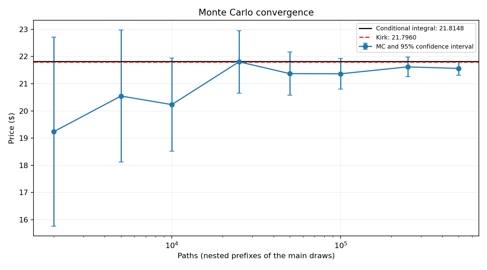
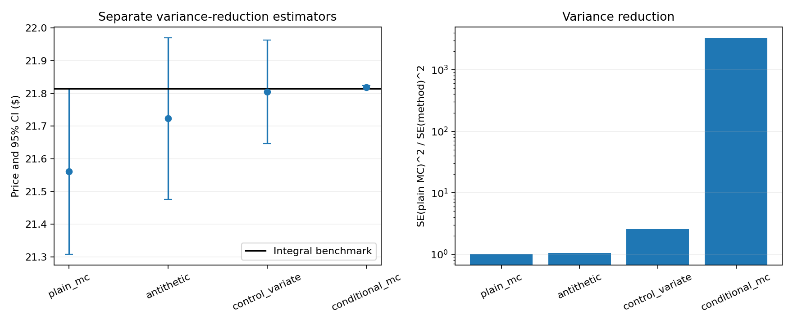
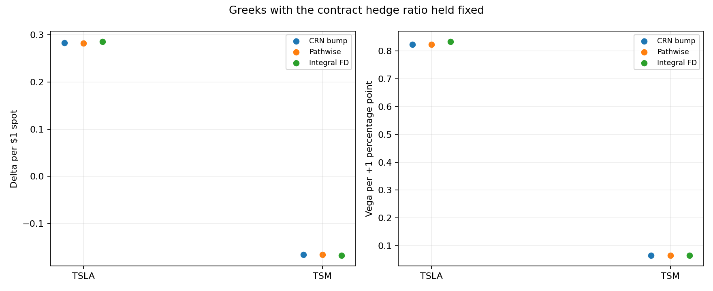
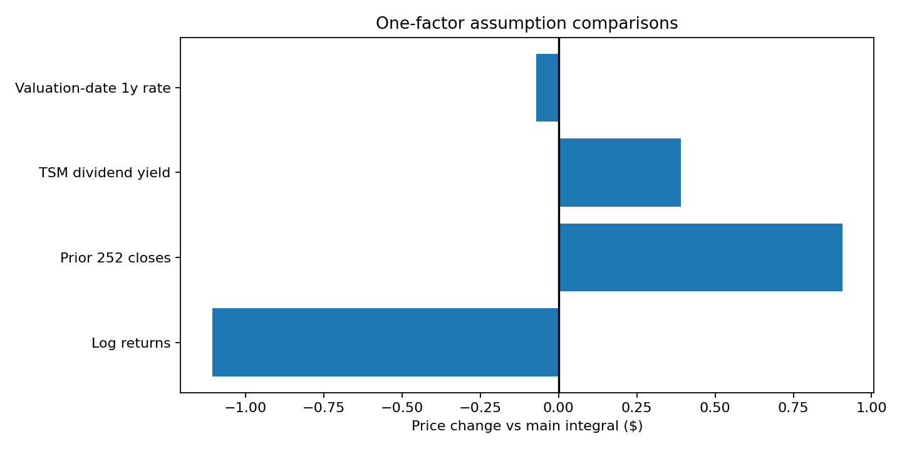
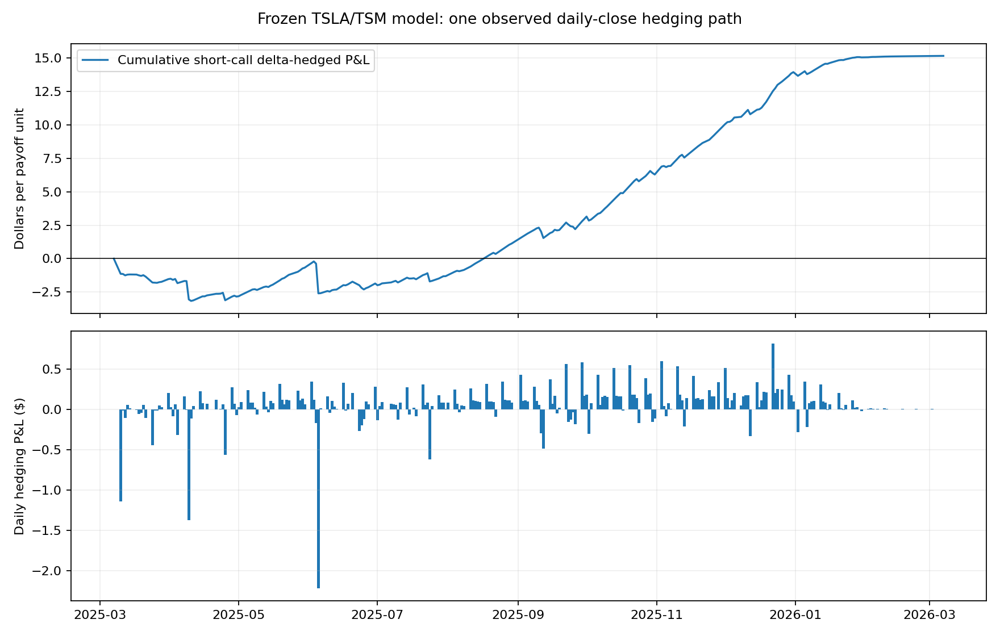

# Monte Carlo Pricing of Equity Spread Options — TSLA–TSM



A European spread call pays `max(S1_T − h·S2_T − K, 0)` on TSLA/TSM. Correlated GBM gives it no closed form, so I price the same contract three ways — 500,000 correlated risk-neutral Monte Carlo paths, Kirk's approximation, and a one-dimensional exact conditional integral — and use the gaps between them. The gaps are the point. One of them surprised me: the headline 1.1% MC-vs-Kirk difference is almost entirely Monte Carlo sampling error, not approximation error. MC sits 1.96 standard errors below the exact-model value of 21.8148; Kirk sits 0.09% away from it. A reader who stops at "the two methods disagree by 1.1%" blames the wrong model.

*Extended and independently rebuilt from a team project in a remote research program led by Prof. David Shimko (NYU Tandon). Authorship and scope notes at the bottom.*

## Contract and calibrated inputs

| Input | Value |
| --- | --- |
| Valuation date | 2025-03-07 |
| Spots (TSLA, TSM) | 262.67001343, 177.10000610 |
| Strike K / maturity | 200 / 1 year |
| Contract hedge ratio h | 1.4831733731 (spot ratio, held fixed everywhere) |
| Risk-free rate | 4.31% continuous; both dividend yields 0 in the main result |
| Calibration window | 252 calendar-2024 closes → 251 daily simple returns |
| Vol TSLA / vol TSM | 0.6362179460 / 0.4048710780 (sample SD, ddof=1, ×√252) |
| Correlation | 0.2400065621 |

## Run it

```bash
pip install -r requirements.txt
python run_analysis.py
```

The calibration panel is a Bloomberg export and is **not redistributed** — Bloomberg terms don't allow it, so `data/tsla_tsm_prices_2020_2025.csv` is gitignored. To rerun everything, drop your own TSLA/TSM daily-close export (2020-01-02 → 2025-03-07) at that path and check it against the SHA256 in [data/README.md](data/README.md); the script then regenerates the tables and figures below into `results/`. Without the panel the suite still runs — every pricing, quadrature and Greek check uses the contract inputs recorded in `results/summary.json`, and only the two calibration-from-prices tests skip. Requires Python ≥ 3.11 (verified on 3.12 and 3.13). Tests lock the full-precision numbers (`python -m pytest`).

## Three prices for one contract

| Quantity | Value |
| --- | --- |
| Plain MC (500k paths, seed 20260903) | 21.5612 |
| MC standard error | 0.1291 |
| Kirk approximation | 21.7960 |
| Exact conditional integral (128-node Gauss–Hermite) | 21.8148 |
| (MC − Kirk) / Kirk | −1.08% |
| (Kirk − integral) / integral | −0.09% |
| (MC − integral) / MC SE | −1.96 SE |

The integral is exact for this GBM model: condition on Z2, write S1's terminal law as lognormal with level mean `m1(z)` and log SD `v = σ1·√T·√(1−ρ²)`, take the Black–Scholes conditional expectation `m1·N(d1) − k·N(d1−v)`, and integrate over Z2. 100/128/256 Gauss–Hermite nodes and independent adaptive quadrature on ±12 normal SDs agree to <1e−10. At K = 0 the integral and Kirk both collapse to Margrabe's exchange-option formula; unit tests assert the identity.

Read the gaps, not the prices. The MC−integral gap of −0.2536 is 1.96 SE of sampling noise — the seed was kept anyway, because a slightly unlucky draw is an honest outcome. The Kirk−integral gap of −0.0189 is the actual approximation error. Same contract, two gaps, two different causes.

## Variance reduction — the right conditioning is worth 3,000x

| Method | Price | SE | Error vs integral | Variance reduction |
| --- | --- | --- | --- | --- |
| plain MC | 21.5612 | 0.1291 | −0.2536 | 1.00 |
| antithetic | 21.7234 | 0.1261 | −0.0914 | 1.05 |
| control variate | 21.8055 | 0.0807 | −0.0093 | 2.56 |
| conditional MC | 21.8195 | 0.0022 | +0.0046 | 3318 |

Same 500k-path budget, same seed discipline, four estimators. Antithetic pairs barely help — the payoff is a kinked `max`, so opposite shocks don't cancel across the kink. Discounted S1 and h·S2 as control variates (analytical expectations, coefficients fit on an independent 10k pilot) buy 2.5x. Conditional MC simulates only S2 and integrates S1 out analytically; variance falls by a factor of ~3318. The method choice matters more than the path count.



## Greeks — three estimators, one contract convention

| Greek | CRN bump | Pathwise | Integral finite difference |
| --- | --- | --- | --- |
| delta TSLA (per $1) | 0.282656 | 0.282600 | 0.285420 |
| delta TSM (per $1) | −0.166096 | −0.166050 | −0.167584 |
| vega TSLA (per +1 vol pt) | 0.823023 | 0.822986 | 0.833191 |
| vega TSM (per +1 vol pt) | 0.065840 | 0.065870 | 0.066018 |
| correlation sens. (per +1 pt) | −0.205879 | — | −0.207993 |

Bump sizes: 1% of spot, 0.01 absolute vol/correlation for the CRN bump; 0.01% of spot, 0.0001 absolute for the integral finite difference. Every calculation holds the contract's h fixed — including spot bumps. Pathwise and bump share the same normals, so their agreement is a consistency check, not independent evidence; the integral finite difference is the independent number, and it lands within MC error of both. An added validation harness checks each pathwise delta/vega against the integral FD within 3 of its own standard errors ([greek_validation/independent_greeks.csv](greek_validation/independent_greeks.csv) — all four pass).



## The real price risk is in your inputs

This is the question I care about most, and the answer isn't in the Greeks. Change one calibration assumption at a time and re-price the same contract:

| One-factor change | Integral price | Δ vs main |
| --- | --- | --- |
| main: simple returns, calendar 2024 | 21.8148 | — |
| log returns instead of simple | 20.7082 | −1.1067 |
| prior 252 closes (through 2025-03-06) | 22.7220 | +0.9071 |
| TSM trailing cash dividend yield 1.31% | 22.2048 | +0.3900 |
| valuation-date 1y Treasury 4.05% | 21.7443 | −0.0705 |

Shift the calibration window by a few weeks and the price moves +0.91. Swap return definitions and it moves −1.11. Both dwarf Kirk's 0.09% approximation error. For a desk making prices on model outputs: the model is not the fragile part — the inputs are. Dividend source is TSMC's own dividend history; rate source is the Treasury's daily par-yield curve (recorded in `data/assumption_inputs.json` with retrieval date).



## Out-of-time extension — daily delta hedge on the realized path

Sell one unit at the MC premium, hedge daily with model deltas against 251 realized closes (2025-03-07 → 2026-03-06), fund the cash account at r. Cumulative P&L: **+15.17** per contract; daily hedge-error increments have SD **0.26**. Realized TSLA/TSM vols came in below the calibrated ones (0.603/0.378 vs 0.636/0.405) and realized correlation printed **0.53** against a calibrated 0.24 — the second-order attribution is dominated by that covariance difference, not by the original premium. That's the input story again, one year later, marked to a real path. Full ledger and attribution: [out_of_time/README.md](out_of_time/README.md). LSEG closes are not redistributable; the repo ships the download script and SHA256 manifest instead.



## Provenance and authorship

Extended and independently rebuilt from a team project in a remote research program led by Prof. David Shimko (NYU Tandon) — not an NYU course. The original scope was a plain MC spread pricer benchmarked to Kirk. I rebuilt the code and added: the exact conditional-integral benchmark and quadrature checks, the four-method variance-reduction comparison, three-way Greek estimation with cross-checks, the assumption-sensitivity study, and the out-of-time delta hedge. The design of each validation, and the interpretation of every number above, are mine; parts of the implementation were drafted with AI assistance and reviewed line by line. Tests pin every quoted number. The price panel is a Bloomberg export (SHA256 in [data/README.md](data/README.md)) and is not redistributable; corporate-action provenance beyond the vendor's own adjustment flags is limited, which is a stated limitation, not a silent assumption.

## Limitations

Historical-return calibration does not fit implied volatilities. GBM assumes constant vols and correlation, lognormal terminal prices, frictionless continuous trading, and a flat rate. The main result deliberately ignores dividends; the dividend row is a trailing-yield proxy, not a forecast of discrete ADS payments or FX, and the rate row is a maturity-matched flat-rate proxy, not a bootstrapped discount curve. "Exact" means the numerical expectation inside this GBM model — it validates the integration, not the model against market quotes. Pathwise and bump estimators share random numbers, so their match is not independent validation. The out-of-time hedge is one realized path under zero fees and zero dividends; a single path cannot estimate cross-path hedge-error variance. Runtime measurements are machine-dependent.
