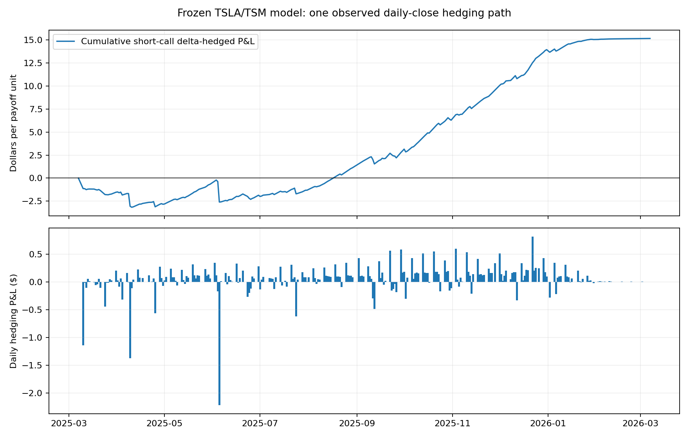

# 2026 out-of-time revalidation — the original TSLA/TSM contract

The original valuation date is 2025-03-07 and the calendar expiry falls on **2026-03-07, a Saturday**. The contract says nothing about non-trading-day settlement, so this check prices against the previous trading day's close, **2026-03-06** — not against a Saturday print that doesn't exist. TSLA **396.73**, TSM **338.89**; `max(S1 − 1.4831733730952126·S2 − 200, 0)` settles at **0**. That is one realization. It cannot tell you whether the 21.5612 premium was right, and it is not a verified settlement price of any listed contract.

Both stocks' **251 actual closing prices** come from the local LSEG Workspace Python API, field **`TRDPRC_1`**, explicitly `adjustments=['unadjusted']` — real closes, not adjusted-close or total-return substitutes. Request parameters, the raw download table and SHA256 checksums are in [data/manifest.json](data/manifest.json). The main price file's hash:

`51a7c1aff34f859e8eb8b2895fb6a6607bae61e822446eb2e87d5c5fa8c95c75`

LSEG data are not redistributable. To reproduce the download, run `fetch_lseg.py` against your own logged-in Workspace session; the saved results below are checked by `test_oot_hedge.py`.

## Daily delta-hedge ledger

Sell one unit of the call at the main MC premium **21.5612435482**, buy both deltas, finance with a cash account. Every actual trading day re-prices deltas to calendar expiry (ACT/365 remaining) with the **original 500,000 paths, seed 20260903, 1% spot bump, CRN** delta routine; h, σ, ρ and r stay at their original values. Cash accrues at the original continuous r = 4.31%; rebalancing neither injects nor withdraws cash. The initial two-decimal LSEG close differs from the main CSV float close by about 1e−5 dollars — the main price file is untouched. The Saturday row only adds one day of cash funding and the reference-settlement flag; it invents no market observation.

The zero-dividend, zero-fee, zero-borrow assumptions carry over from the main run. This is a **model ledger of price plus funding**, not a live P&L with real dividends and fees. Intraday gaps, close execution and discrete rebalancing all stay in the risk. The intermediate option value is a mark from the original MC model — not a tradable quote.

| Metric | Result |
| --- | --- |
| Actual price observations / return intervals | 251 / 250 |
| Short-call delta-hedged cumulative P&L at expiry | **+15.169913 $ per original payoff unit** |
| Daily hedge-error increment SD (ddof=1) | **0.259483 $** |
| Model / realized TSLA vol (simple returns × √252) | 0.636218 / 0.603265 |
| Model / realized TSM vol | 0.404871 / 0.377930 |
| Model / realized correlation | 0.240007 / 0.530669 |

The [daily ledger](results/daily_delta_hedge.csv) carries date, remaining maturity, both deltas, position P&L, cash funding, rebalance cash flows, model option mark, and cumulative/daily P&L. LSEG close prices stay out of the published ledger — they are vendor-licensed, so the columns are dropped at export (P&L columns already carry their effect). The SD above is the sample SD of 250 daily error increments; one path cannot estimate cross-path hedge-error variance at expiry.

## Volatility, covariance and where the P&L came from

The exact integral price and its finite-difference deltas appear only in attribution — they never replace the main hedge. Second-order error for the short call is approximated by

`−0.5·Γ11·(dS1²−σ1²·S1²·dt) − 0.5·Γ22·(dS2²−σ2²·S2²·dt) − Γ12·(dS1·dS2−ρ·σ1·σ2·S1·S2·dt)`,

weighted by the model gammas at the start of each day and carried to expiry at r. With the initial MC-vs-exact price gap, the CRN-delta-vs-exact-FD-delta gap, and the residual:

| Attribution leg (short 1 call, long both deltas) | $ at expiry |
| --- | --- |
| initial_main_MC_price_minus_exact_model | −0.264766 |
| main_CRN_delta_vs_exact_FD_delta | +0.050387 |
| TSLA_realized_quadratic_variation_vs_model | +9.162043 |
| TSM_realized_quadratic_variation_vs_model | +1.811795 |
| realized_cross_variation_vs_model_covariance | +4.191240 |
| discrete_hedging_higher_order_and_carry_residual | +0.219215 |

Realized vols came in below the model and realized correlation above it — consistent with this path's positive hedge P&L. The third and fifth legs move together: the cross-variation leg is a **joint covariance difference**, mixing volatility and correlation changes, so it is not a pure causal ρ contribution. Second-order attribution and the residual are explanatory approximations — not an identified causal split. Discrete hedging, jumps, higher orders and funding approximations land in the residual; unmodelled dividends and fees are a further gap.

Re-run offline: `python out_of_time/run_hedge.py` from this project's root. Re-download with `fetch_lseg.py` (separate install from `requirements-fetch.txt`). The original pricer and main results stay as they are.
